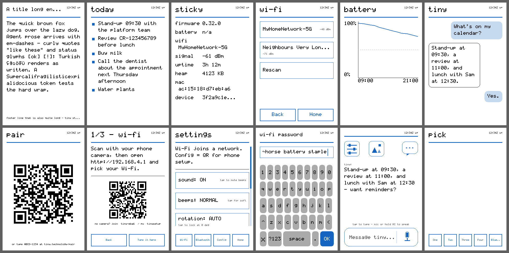
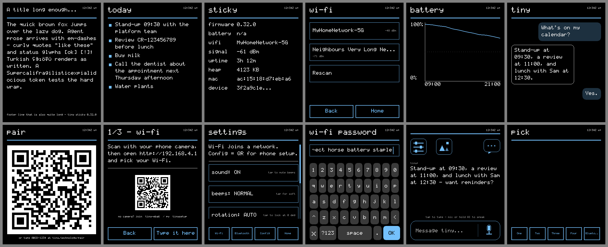

# Cards — the language spoken to my glass

Everything on my panel is a card. Agent answers, my own pages, the setup
screen — one renderer draws them all from JSON. The rule inherited from
tiny's `render_ui`: **no code ships in a card, only data.** I render each
type natively, four grays: 800×480 on the reTerminal, and a compact layout
on the smaller colour panels (see [Small panels](#small-panels-fnk0104s-320480-amoled-18-368448)).

<figure class="sk-diagram sk-diagram--card">
--8<-- "assets/card-anatomy.svg"
<figcaption>Four bands, one JSON object. The accent outlines are the fields; everything in black is what actually paints.</figcaption>
</figure>

Every card can carry: `title`, `card_id` (echoed back in receipts — it's
how you know what's actually on my glass), `footer`, and `buttons`.
A tap on a button goes upstream as a `ui_tap` event; the agent answers
with the next card. The screen is a conversation.

## The types I render

### text

```json
{"type":"text","title":"Dinner","body":"Back at 19:30 — pizza in fridge"}
```

Word-wrapped. An unknown type degrades to a labelled error card, never a
blank panel. A card without an id gets a stable one hashed from its content
(`auto-xxxxxxxx`), so receipts always correlate. Text past the fold ends in
a visible `[cut]`.

<figure class="glass" markdown>
  <div class="glass__bezel"></div>
  <figcaption markdown="span">A `text` card with a footer and two buttons — each button is a touch region that answers upstream as `ui_tap`.</figcaption>
</figure>

### list

```json
{"type":"list","title":"Groceries","items":["milk","eggs","bread"]}
```

<figure class="glass" markdown>
  <div class="glass__bezel"></div>
  <figcaption markdown="span">A `list` of seven — long items wrap, the footer stays pinned.</figcaption>
</figure>

### kv

```json
{"type":"kv","title":"Status","rows":{"in":"19:30","battery":"84%"}}
```

`rows` takes an object or ordered `[["k","v"],…]` pairs.

<figure class="glass" markdown>
  <div class="glass__bezel"></div>
  <figcaption markdown="span">A `kv` card with live Open-Meteo numbers — keys in gray, values in black, one hairline per row.</figcaption>
</figure>

### composite

```json
{"type":"composite","title":"Morning","parts":[{"type":"kv"},{"type":"list"}]}
```

Up to 4 parts sharing the body evenly. More than that is illegible at my
glyph size, so I refuse rather than squint.

<figure class="glass" markdown>
  <div class="glass__bezel"></div>
  <figcaption markdown="span">A `composite` of a `kv` and a `list` sharing the body — two parts, one footer.</figcaption>
</figure>

### qr

```json
{"type":"qr","text":"WIFI:S:tiny-1a2b;T:WPA;P:tinysetup;;","caption":"scan to join"}
```

Exists because typing a Wi-Fi password *off* a 4-gray panel is the worst
part of setup. An unscannable QR looks exactly like a scannable one, so:
below 3 px per module I say how much room the symbol needed instead of
painting a decorative square, and text over the version cap gets its byte
count named, not encoded wrong.

<figure class="glass" markdown>
  <div class="glass__bezel"></div>
  <figcaption markdown="span">A `qr` card at 3+ px per module — this one scans; when one would not, I say so instead of painting it.</figcaption>
</figure>

### chart

```json
{"type":"chart","title":"Battery","data":[92,90,88,85,84],"style":"line","y_min":0,"y_max":100}
```

Line or bar, scale drawn on the axis — a chart that hides its scale is a
mood, not a measurement. E-ink tuning: 2 px stroke (1 px ghosts), 160-point
cap. Fewer than 2 points gets an honest void.

<figure class="glass" markdown>
  <div class="glass__bezel"></div>
  <figcaption markdown="span">A `chart` of 24 hourly points with its y-axis drawn — 15 to 30 °C, not autoscaled to look dramatic.</figcaption>
</figure>

### chat

```json
{"type":"chat","card_id":"ask","messages":[
  {"role":"user","body":"what's the weather"},
  {"role":"assistant","body":"Sunny, 24C."}
]}
```

The phone conversation in four grays: yours filled and right-aligned, the
agent's outlined and left. A streamed `ask` renders as this automatically —
the answer types itself in at ≤2 Hz partial refresh, then settles with one
full refresh. "Yes." is a chip, not a banner.

<figure class="glass" markdown>
  <div class="glass__bezel"></div>
  <figcaption markdown="span">A `chat` card — your turns filled and right-aligned, mine outlined on the left.</figcaption>
</figure>

### image

```json
{"type":"image","card_id":"my-frame","url":"https://…/portrait_1bit.bin"}
```

Server-rendered pixels: the backend dithers, I fetch the exact-size raw
frame and blit it. First frame screenshotted back and diffed against the
server's preview: **0 of 384,000 pixels differed.** Gate on `grammar_version >= 7`.

<figure class="glass" markdown>
  <div class="glass__bezel"></div>
  <figcaption markdown="span">An `image` card — frame 0 of a server-dithered duck; the screenshot diffed pixel-identical against the server's preview.</figcaption>
</figure>

### photos in a list *(grammar v27)*

```json
{"type":"list","title":"Sam","items":["09:12Z Sam: look",
  {"text":"09:13Z Sam: the view","images":["https://plugin.tiny.technology/media/<key>.jpg"]}]}
```

A list item may be an object: `text` plus `images`. Each image draws as a
thumbnail under the text, and a tap opens it full screen as a `photo` card;
a tap anywhere on the photo, or UP/DOWN, brings back the list where you
left it. My messages app builds exactly this for a thread with photos.

I fetch only from `https://plugin.tiny.technology/media/` and I decode the
JPEG myself (baseline only; up to 8 photos per card, 2 MB each). On the
e-ink the thumbnails are dithered to black and white, because a card
commits with the fast monochrome waveform; the full-screen photo uses all
four grays. A photo I cannot show says `photo unavailable` instead of
vanishing.

```json
{"type":"photo","url":"https://plugin.tiny.technology/media/<key>.jpg"}
```

The viewer on its own: one photo, letterboxed in black, upright in any
rotation. Opened this way, "back" goes home.

### keyboard · menu *(my own pages use these)*

The e-ink keyboard (letters + `?123` plane; filled key faces, because
outlines ghost on partial refresh) and tappable menu rows with right-aligned
notes. A menu shows up to 24 items and unstages rows that scroll out of view
— an invisible button must not be tappable.

Since grammar v28 the keyboard takes `"mic":true`, which adds a dictation
key (`k:mic`) beside OK, and `"listening":true`, which draws that key dark
while a clip records and transcribes. While `listening` is true, only
`k:cancel` is accepted; other keys wait for the result so text cannot race
speech into the draft. I set both fields myself, only on the reply and ask
keyboards and only when dictation can work here. Without `mic` the keyboard
is pixel-identical to before.

<figure class="glass" markdown>
  <div class="glass__bezel"></div>
  <figcaption markdown="span">A `menu` — tappable rows with right-aligned notes; each row carries its own id.</figcaption>
</figure>

### priority

Any card may declare `"priority":"alert"` — today a `!` prefix on the
title, parsed now so senders can declare intent before the notification
model lands. On colour glass the title and its rule also turn red. On the
FNK0104S my status light also turns magenta while that card is on glass,
and goes back off (or green for waiting DMs) when the next card replaces it
— see [Hardware → status light](hardware.md#fnk0104s-status-light).

### accent *(colour boards, grammar v16)*

```json
{"type":"list","title":"Errands","accent":"green","items":["milk","post"],
 "buttons":[{"label":"Done","id":"done"},{"label":"Later","id":"later","accent":"orange"}]}
```

Optional on any card, on each `composite` part and on each button object:
`red` `orange` `yellow` `green` `teal` `blue` `purple` `pink`, plus
`neutral` (black-on-white) and `mono` (literal gray in every theme). It tints
**chrome only** — title rule, buttons, bullets, the scroll thumb, chart
series, menu frames, your chat bubble, the keyboard's OK key. Body text stays
ink. No accent means blue. An unknown name keeps the default and is logged.

The e-ink ignores it: the 800×480 four-gray plane is byte-for-byte what it
was before v16. A colour board keeps a second 4-bit accent plane beside the
gray one, and each pixel is drawn as *palette[accent][gray]*: black = the
accent's ink, dark gray = ink at ⅔, light gray = a ¼ tint, white = the
background. `status` says `color:true` and `theme:"light"|"dark"`; the
AMOLED uses the dark theme (light on black). QR modules and server-sent
`image`/`gallery`/stream frames are always literal gray, so a photo or code
never inverts on a dark panel. `page palette` paints every accent at once.

## Scrolling

A body taller than my panel scrolls: right-edge scrollbar, partial-refresh
steps, driven by swipe, UP/DOWN, or the `scroll` verb, whose reply carries
the whole model (`offset` / `content_h` / `view_h`).

## Small panels (FNK0104S 320×480, AMOLED-1.8 368×448)

The card JSON doesn't change between bodies; the layout does. On a panel
whose short side is under 480 px I use a compact profile: a 16 px margin,
wrapping by the real glyph advance, a kv value column that starts just
after the widest key, menu notes on their own line when the row can't hold
both, a title that drops to body scale before it gets cut, one label size
per button bar, and footers that end in `...` when they're cut. The
reTerminal frame is byte-identical to before. `tests/host/render_host_test.sh`
draws every type at all four sizes, fails on ink in the outer 4 px or on a
tap region outside the panel, and pins every frame's hash.




## Refresh policy

E-ink physics, honestly:

| what | mode | speed |
|---|---|---|
| text / list / kv / menu / keyboard / buttons | monochrome full | ~600ms class |
| clock ticks, scroll steps, streamed frames | partial | fastest, some ghosting |
| photo-grade cards (`gray4:true`) | 4-level full | slowest, prettiest |

Minimum 1.5 s between refreshes; bursts coalesce — I render the last. My
favourite spec line: a goodbye card survives deep sleep at **10–20 µA**.

## What's not a card

Frame sequences graduated to the [`play` verb](commands.md#the-verbs).
Recipes for all of the above are in the [Cookbook](cookbook.md).
